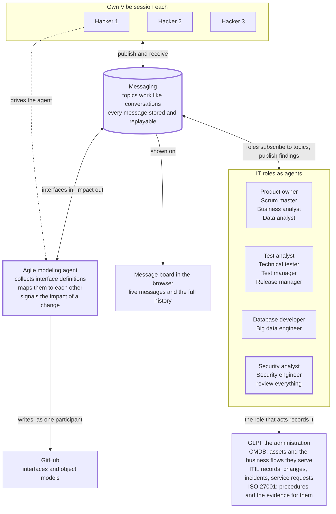
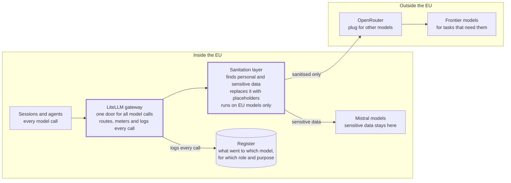
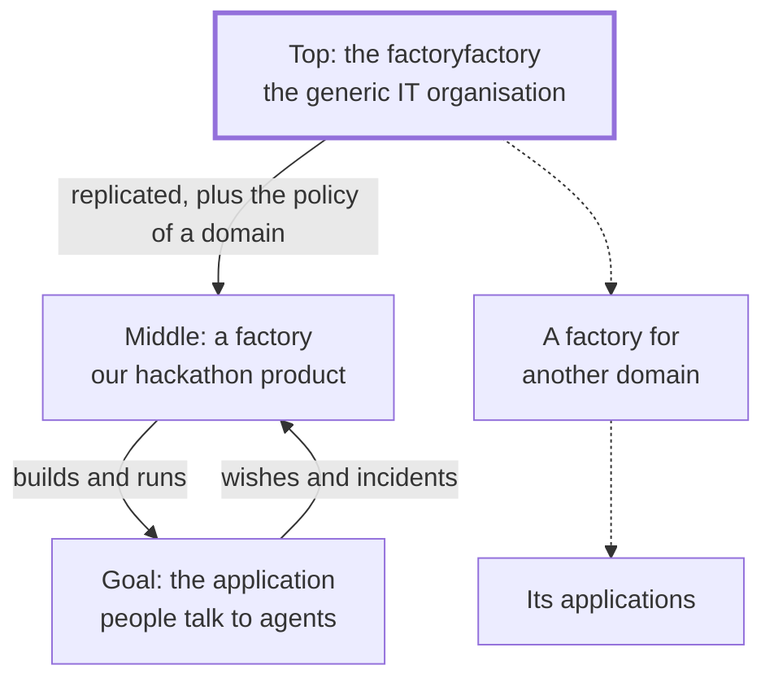

# An agent organisation that works like an IT department

A proposal for the Mistral hackathon. Read the first screen to decide whether you want to join.

The same proposal as a web page, with the drawings laid out by hand: https://bvd.github.io/factory-factory-mistral-hackaton/

## In one minute

- **What we build.** A way for a team to work together on one Linux server: each person in an own Mistral Vibe session, connected by a messaging system, with an agent that negotiates the interfaces between everyone's parts.
- **Why it is worth a hackathon.** Around that core we put the roles of a traditional IT organisation (product owner, testers, release manager, security) as agents, each with a person behind it, and we keep the records a security audit asks for. That shows agents can work inside the standards companies already trust, such as ITIL and ISO 27001.
- **What you would do.** Build one of the parts (sessions, messaging, the modeling agent, a role agent, the administration), or own one of the roles and shape how its agent behaves.
- **What we have at the end.** A working collaboration model, used to build one concrete product, and written down so it can be copied.
- **What you need.** A laptop with an ssh key. Nothing else: the server is ready.

## The rules

1. **We start on an empty server.** A fresh Linux machine with git and an account for each of us. Everything else is built during the hackathon.
2. **We use only Mistral models**, as far as that is possible within the time we have. This holds for our own sessions and for every agent we build.

The design leaves room to plug in other models for a task that needs them, but only behind the sanitation layer described below.

## How we work together

Everything except GitHub runs on the one Linux server, behind one login.

The whole collaboration runs through stored messages. People and agents publish to the same topics, the modeling agent turns what it reads into shared interfaces, and every role records what it did. Every model call in this picture goes through the model gateway shown further down.

- **Own session.** Every hacker works in an own account with an own Mistral Vibe session. A session can publish messages and receives the ones meant for it.
- **Messaging.** Topics work like conversations. Everything is stored, so a message can be read back later, by a person on the board or by an agent that joins late.
- **The agile modeling agent.** A negotiator between our parts. It picks up interface definitions, maps them to each other and says who is affected when one changes. One of us drives it; everyone can talk to it from their own session.
- **IT roles.** Each role is an agent that follows the topics that matter to it. The person behind the role sets its mandate. When that person is away the agent keeps the work moving; when they are back they catch up and sharpen the agent.
- **GLPI.** The assets we build and how they relate, every change, incident and request, and the procedures with their evidence. This is what makes the team look like a managed IT environment to an auditor.

## Models and data protection

AI is used inside EU jurisdiction. Personal and sensitive data is handled by EU models only. A stronger model from elsewhere can be plugged in for a hard task, but it only ever receives a sanitised version.

No session or agent calls a model directly. The sanitation layer decides what a call may contain before it goes anywhere. Answers come back the same way, and the placeholders are replaced by the real values inside the EU.

- **One door.** All model calls go through one gateway on our own server (LiteLLM). It knows which role is asking, for what, and which model answers.
- **Sensitive data stays in the EU.** It goes to EU models only, and the sanitation layer itself runs on EU models only. No party outside the EU receives it, so no authority outside the EU can demand it there.
- **Other models stay possible.** For a task that needs a stronger model, names and other identifying data are replaced by placeholders, and only that version leaves, through OpenRouter.
- **The right to know.** Every call is in the register. Together with the stored messages it answers the question: what happened with my data?
- **The right of deletion.** Everything that holds personal data is in systems we run in the EU: the messages, the register, GLPI. It can be deleted or made anonymous there. What left the EU held no personal data.
- **Between people.** Each person's work stays in an own session, and the parts meet through interface definitions: a team shares the shape of its data and keeps the data itself.

This covers the main GDPR rights reasonably for a hackathon. It is a design, not a legal review.

## Three layers

- **Top: the factoryfactory.** The organisation of the first drawing: roles, messaging, GLPI, single sign-on and security review, without any domain.
- **Middle: a factory.** The same organisation, copied once and given the knowledge and policy of one domain. This is where project organisation meets a business domain, and where we build our hackathon product.
- **Goal: the application.** People who need no IT knowledge talk to agents: a business analyst, a client happiness manager, helpers, and their own agent, which can represent them.

The dashed boxes show that the same copy works for any other domain.

## Build order

Each step works on its own and is the ground for the next.

| | Step | Done when |
|---|---|---|
| 1 | **A Vibe session for everyone** | Each person runs Mistral Vibe in their own account on the server. |
| 2 | **The model gateway and the sanitation layer** | A text with a name in it reaches a model outside the EU without the name, the answer comes back with the name in place, and the register shows both calls. |
| 3 | **Messaging and the board** | A message published in one session arrives in another, shows on the board, and can be replayed later. |
| 4 | **The agile modeling agent** | It picks up two interface definitions, maps them, reports the impact of a change to the people affected, and writes the result to GitHub. |
| 5 | **IT roles and GLPI** | The change of step 4 stands in GLPI as a change, linked to the assets it touches and reviewed by the security role. |
| 6 | **One factory, one product** | The same setup, given the policy of one domain, is used to build the product the team chooses. |

## Ready before we start

- An empty Linux server (Debian 12, 8 cores, 32 GB memory, 300 GB disk) with git and internet access, separated from everything else.
- An account of your own on it. You are an administrator of the machine, together with the rest of the team.

Nothing else is installed. Steps 1 to 6 are the hackathon.

## How to join

1. Ask the organiser for a role code and the address.
2. Log in there with a Google account and redeem the code.
3. Paste your **public** ssh key (the file that ends in `.pub`). The page shows the command to log in.

No Google account? Send the organiser your public ssh key and you get an account the same way.

To push from the server with your own GitHub identity, log in with agent forwarding (`ssh -A`), or put a key of your own on the server. The server is temporary: what is not pushed is gone afterwards.

## Questions for the team

- **Which messaging software?** It has to store and replay messages, group them in topics, offer a board in the browser, and let agents connect. Candidates to compare on the first morning: a chat server with topics and a bot interface, such as Zulip, Matrix or Mattermost, or a message broker with a stored log, such as NATS JetStream, with a small board of our own.
- **Whose GitHub account does the modeling agent write with?** A token for one repository only would keep that small.
- **Where does GLPI run?** A fresh one on the hackathon server is the simplest.
- **What counts as sensitive?** The sanitation layer needs one list we all agree on: names, contact details, health and financial data, and what else.
- **Does Mistral's agreement cover what we promise?** To check: its processing agreement, that our data is not used for training, how long it is kept, and where it is processed.
- **Can each Vibe session send its calls through the gateway?** If not, a session talks to Mistral directly and only the agents use the gateway.
- **Which product do we build in step 5?**
